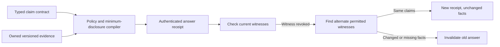

# Living Evidence Gateway

**An executable experiment: answers whose evidence can be repaired without silently changing their facts.**

Most retrieval demos stop after producing an answer and citations. This prototype treats evidence as a versioned dependency:

1. Compile the lowest-cost permitted evidence bundle for an explicit set of typed claims.
2. Bind those claims to their witnesses using an authenticated receipt.
3. Recheck source versions, ownership, freshness and composition restrictions.
4. If a witness disappears, try to **rebase** onto other permitted evidence.
5. If the underlying facts changed, invalidate the old answer instead of preserving it.

This is a standalone Python standard-library implementation using fictional data. It has no database credentials, model dependency, customer records or connection to an internal deployment. It is not a general natural-language truth verifier or a claim of a new research algorithm.

## Run it

Python 3.10 or newer, from the repository root:

```bash
python -m witness_gateway.demo
python -m witness_gateway.benchmark
python -m unittest discover -s tests -v
```

The demo executes real compiler, signature, revocation and repair logic. The benchmark builds synthetic cases; it does not contact any model or database.

## What is distinctive about this implementation?

The engineering experiment combines **minimum-disclosure selection**, **composition-aware restrictions**, **version-bound receipts** and **same-answer witness repair** in a small inspectable program.

For example, two evidence units might each be permitted separately, while their combined sensitivity tags violate policy. The compiler rejects that combination and looks for an allowed alternative. If the selected source is later revoked, it can repair the witness set only when the typed claim values remain identical.

These ingredients have prior art. We present the integration and executable experiments, not a first-ever invention. See [related work](docs/RELATED_WORK.md).



## Implemented and proposed

| Item | Status |
| --- | --- |
| Scoped in-memory evidence store | Implemented |
| Exact bounded evidence-bundle selection | Implemented; at most 18 eligible candidates |
| Field-key, source, freshness and disclosure budgets | Implemented for typed evidence |
| Forbidden combinations of trusted sensitivity tags | Implemented |
| HMAC-authenticated scope/policy/version-bound receipts | Implemented |
| Verification and same-claim rebase | Implemented |
| Adversarial unit tests and synthetic benchmark | Implemented |
| Arbitrary natural-language claim extraction or verification | Not implemented |
| Live database/model connectors, user authentication or production deployment | Not part of this standalone prototype |
| Larger control/data-plane design | [Architecture proposal](docs/BLUEPRINT.md) |

## Read and inspect

- [How the prototype works](docs/LIVING_EVIDENCE.md)
- [Synthetic experiment and limitations](docs/EXPERIMENT.md)
- [Related work and novelty boundaries](docs/RELATED_WORK.md)
- [Source implementation](witness_gateway/core.py)
- [Executable tests](tests/test_witness_gateway.py)
- [Original generic architecture](docs/ARCHITECTURE.md)
- [Security model](docs/SECURITY_MODEL.md)
- [Offline architecture illustration](explorer/index.html)

The offline illustration is conceptual; the Python demo and benchmark execute the actual prototype.

## Trust and scope

The evidence store, policy annotations, authenticated scope, clock and signing key are trusted application inputs. A receipt proves integrity and binding under that trust model, not that a source is truthful. Costs are policy annotations, not a formal measure of privacy leakage.

The fixture signing key is public sample material and must never be used for a real deployment. Exact decimal values should be represented explicitly as strings. No live client information is included in this repository.
