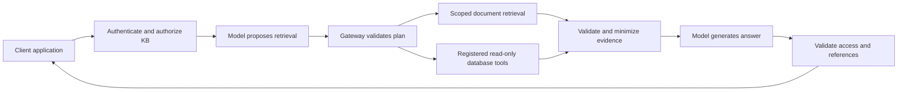

# Knowledge Gateway

An architecture for connecting multiple client applications to a shared language model while keeping retrieval scoped to each client's knowledge.

This repository contains a reference design and illustrative examples. It does not contain a deployable server, model weights, client datasets, internal infrastructure details, or production configuration.

## What it does

An application sends an authenticated question and a knowledge-base identifier. The gateway verifies ownership, builds a permitted source catalog, validates the model's retrieval plan, fetches approved evidence, and asks the model to produce an answer with references.

## Design goals

- Separate client ownership, credentials, conversations and retrieval state.
- Fetch changing database facts through approved parameterized tools.
- Preserve document versions, page references and extraction quality.
- Use document structure where appropriate to select coherent sections.
- Treat model plans and retrieved content as untrusted input.
- Make missing evidence and incomplete results explicit.

The gateway combines established multi-tenant retrieval-augmented generation, policy enforcement and tool-based database access. Its overall architecture is not presented as a novel research method.

## Proposed next architecture

The [evidence-first blueprint](docs/BLUEPRINT.md) expands the design into separate control and data planes, typed operations, server-issued execution capabilities, freshness contracts and layered answer validation. These are proposals, not claims about a deployed system or original research.

Explore the fictional request flow locally in [the offline explorer](explorer/index.html). It uses no model, database, account or external network connection.

## Read the design

- [Architecture and request flow](docs/ARCHITECTURE.md)
- [Security boundaries and limitations](docs/SECURITY_MODEL.md)
- [Client onboarding](docs/ONBOARDING.md)
- [Generic API example](examples/request.json)
- [Generic source catalog](examples/source-catalog.json)

## Structure-aware retrieval

A document retriever can use headings and a table of contents to select relevant sections before fetching their text. This design is inspired by the structure-aware retrieval direction explored in [STAIR](https://arxiv.org/abs/2609.03874).

A zero-shot section selector is not a reproduction of STAIR's trained generative retriever. No paper-level accuracy or performance claim is made here.

## Scope

Examples are fictional and illustrate contracts rather than guaranteed model behavior. This documentation is not a claim of production readiness, universal answer accuracy, tenant isolation certification, or measured latency.
