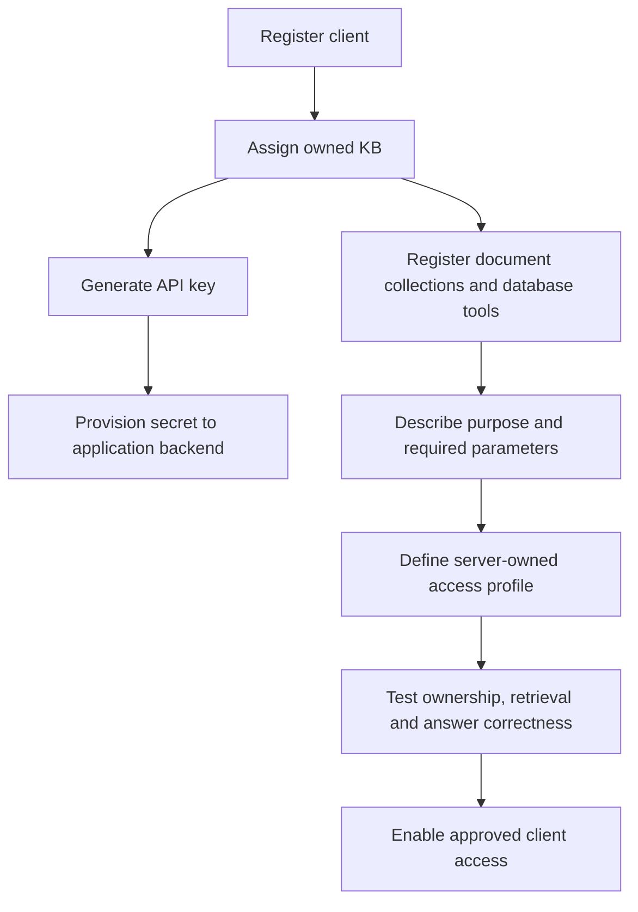
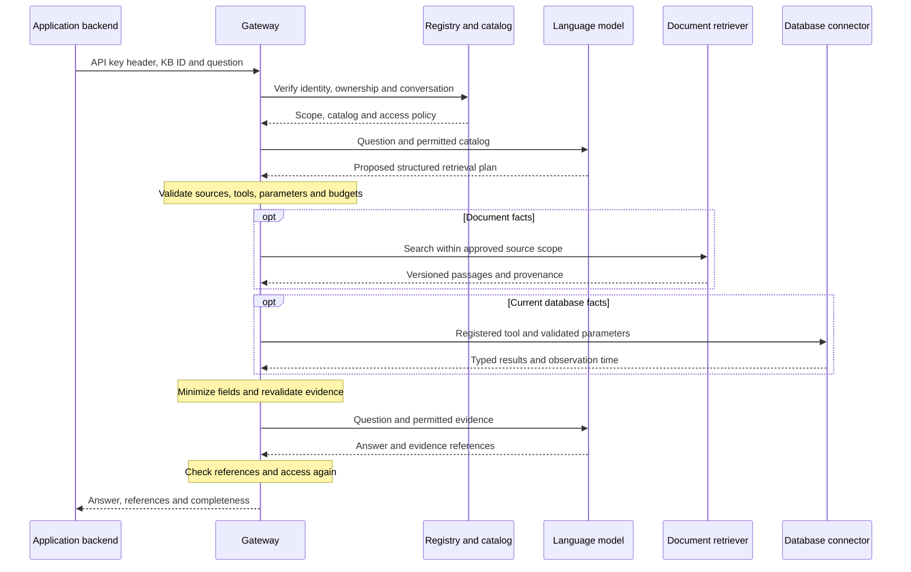
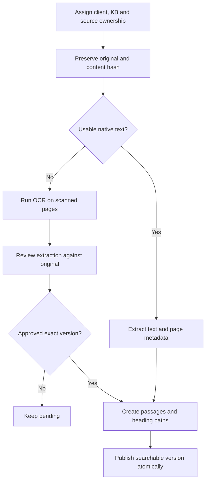
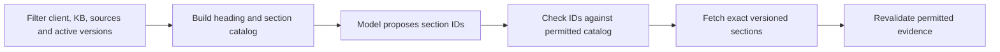

# Architecture

## Components

| Component | Responsibility |
| --- | --- |
| Application backend | Hold its API key and send questions |
| Registry | Resolve client identity and KB ownership |
| Catalog | Describe permitted document collections and database tools |
| Policy layer | Validate selected sources, identifiers, fields and limits |
| Document pipeline | Extract, review, version and index source text |
| Database connector | Execute registered parameterized read-only queries |
| Model adapter | Request plans and grounded answers |
| Evidence validator | Recheck scope, versions, references and completeness |

A KB is the logical knowledge collection owned by a client. It can contain several document collections and approved database sources. A source ID is an identifier, not an access grant.

## Client setup

Client and KB identifiers are assigned during onboarding. API keys are randomly generated; the registry stores hashes. The gateway derives the client from the verified key. A caller cannot establish identity by supplying another client's ID in a question.

## Question flow

The first model call proposes retrieval; gateway code executes it. The model receives neither the application's API key nor source database credentials.

## Document ingestion

OCR happens during ingestion. An answer request searches approved extracted text. Replacing or revoking a document must invalidate its previous evidence.

## Optional table-of-contents routing

The selector receives structure metadata rather than every section body. Empty selection must not silently broaden access. Large structures require hierarchical batching and explicit budgets. This adds a model call for document questions; it does not replace live database tools or OCR.

## Database access

Use fixed, registered SELECT queries and parameter binding. Prefer non-owner, non-superuser database identities with minimal SELECT privileges. Use verified read-only transactions, schema-qualified relations, approved SQL syntax/functions, timeouts and row/byte limits.

Dynamic facts are fetched at question time. Multiple connections and different sources do not provide a universal atomic snapshot. Results must distinguish zero rows, NULL, unavailable sources and truncated lists.

## Conversation and presentation

User history can resolve unambiguous references; it is not authoritative evidence for current records. New topics should not inherit identifiers from unrelated turns, and assistant-invented IDs cannot authorize retrieval.

Long result sets can be rendered as structured tables with a concise answer. If a result is bounded, show its partial status. A slow-motion flow viewer can replay captured events after a real request; replay pacing must be distinguished from actual runtime.
