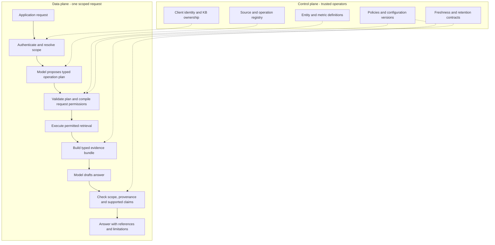
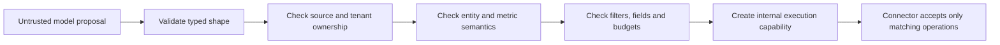
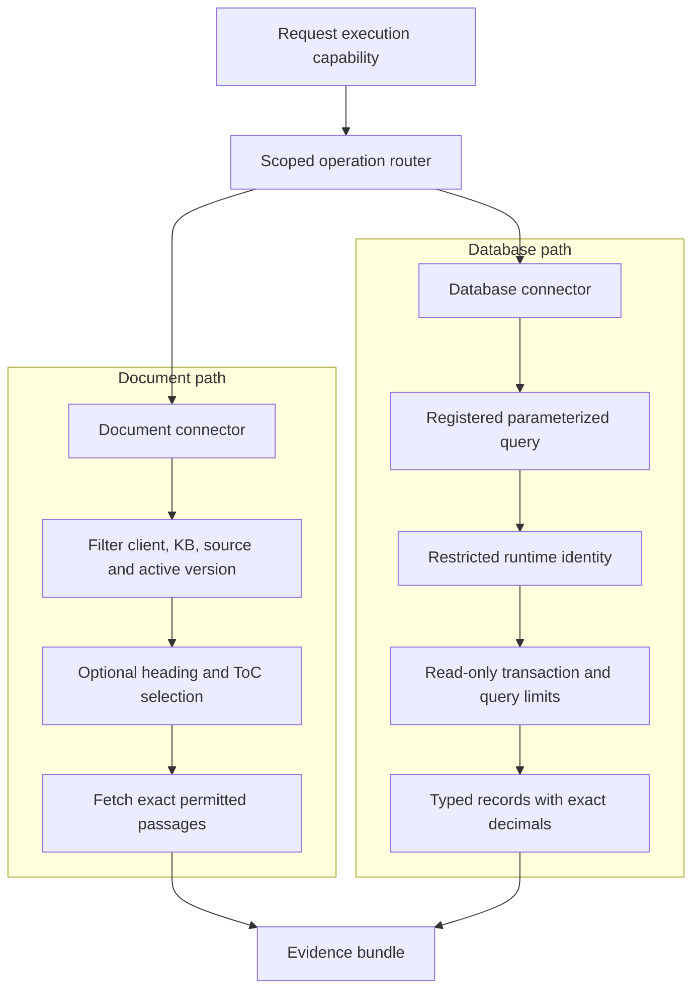
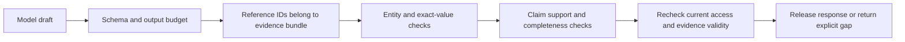

# Evidence-first gateway: architecture blueprint

> Proposed design. This is a public reference architecture, not a description of a deployed customer environment. The components below are design proposals unless explicitly illustrated by a fictional example. No novel security guarantee or research contribution is claimed.

## The central idea

Treat the model as a planner and writer. Make permission, query meaning and evidence lifecycle explicit in gateway code.

A client-owned knowledge base is not an unrestricted bag of text and database tables. It is a catalog of approved operations with ownership, business meaning, output fields, freshness and cost contracts.

Every answer should be explainable as:

**Authenticated request → authorized operation → permitted evidence → supported response**

## 1. Separate control and data planes

The control plane determines what may exist and how it may be used. The data plane handles one authenticated request under that configuration.



Control-plane changes require authenticated operator actions and explicit rollout. A user question, model response or retrieved document cannot mutate source permissions.

## 2. Use a typed operation plan

The planner produces a small intermediate representation rather than SQL or connector instructions.

| Operation kind | Example | What must be defined |
| --- | --- | --- |
| Entity lookup | Current status of order 42 | Entity, identifier, approved field set |
| Registered aggregate | Count orders in an agreed date range | Named metric, filters, grouping and completeness |
| Section retrieval | Return eligibility and exceptions | Approved collection and versioned sections |
| Combined retrieval | Policy plus current record | Each operation's authority and evidence linkage |

```json
{
  "operations": [
    {
      "kind": "entity_lookup",
      "operation_id": "orders.status",
      "arguments": {"order_id": 42}
    },
    {
      "kind": "section_retrieval",
      "operation_id": "policies.search",
      "arguments": {"query": "return eligibility and exceptions"}
    }
  ]
}
```

The model cannot provide raw SQL, database addresses, authentication material or an authorization scope. Arguments are validated against each registered operation's schema and business constraints.

A metric such as "successful contacts" must have a reviewed definition. It cannot be inferred from a column name or treated as synonymous with sent messages.

## 3. Compile permissions for this request

After validation, the gateway creates a request-scoped execution capability. This is a trusted internal object, not an object accepted from API callers.

It binds:

- Verified client, KB and principal ownership.
- Policy and catalog versions.
- Approved operation and source identifiers.
- Authorized tenant/entity/filter scope.
- Output field allowlists.
- Row, byte, call, deadline and query-cost budgets.
- Source freshness requirements and permitted processing destination.

A capability may be an immutable in-process structure. If it crosses service boundaries, protect authenticity, audience, expiry and replay behavior with an appropriate capability protocol. A JSON object alone does not establish authority.



An entity identifier appearing in a question is evidence for reference resolution, not proof that the requester is authorized to access that entity. Server-owned authorization remains the boundary.

## 4. Resolve ambiguity before execution

The gateway should distinguish four outcomes:

1. An approved, unambiguous operation: execute.
2. A potentially supported operation with missing or ambiguous arguments: clarify.
3. An operation outside the caller's authority: deny.
4. An operation unsupported by the catalog: explain the coverage gap.

A policy rejection is not an empty search result. A source timeout is not "no records." An empty model plan is not proof that no relevant document exists.

An optional second routing pass may inspect only already permitted catalog metadata. It must not broaden ownership, fetch unapproved bodies or invent missing database identifiers.

## 5. Keep connectors narrow



Use restricted database identities. Read-only transactions complement permissions; they do not neutralize a privileged login. Do not treat driver-side SQL checks as a substitute for database isolation.

Select minimal columns in the query itself. Output projection provides an additional bound, but cannot undo an overly broad read.

## 6. Make evidence a first-class contract

The evidence bundle is a request-local collection of facts and passages, not a hidden model memory or an unrestricted permanent record store.

Each item carries:

| Field | Meaning |
| --- | --- |
| Evidence ID | Stable reference within the answer |
| Owner and source | Client, KB, source and operation provenance |
| Version or observation time | Document version or database read time |
| Content type | Passage, typed row set or registered aggregate |
| Completeness | Complete, bounded, partial or unavailable |
| Units and semantics | Defined currencies, time zones, metric meaning |
| Transformation lineage | Approved computation or projection applied |
| Freshness status | Whether source age meets the agreed contract |

For related database reads, use appropriate snapshot semantics where practical. Independent sources cannot promise a universal transaction snapshot. An observation timestamp alone does not establish freshness of an upstream replica or imported dataset.

Do not sum payment requests as settled receipts, merge historical snapshots into current totals, or assign a meaning to unknown status codes.

## 7. Verify the response in layers



Schema and citation checks can be deterministic. Exact-value checks can validate structured facts and registered calculations. Full semantic entailment and answer completeness require separate evaluation; another model's approval is not a security proof.

The verifier should support abstention or bounded repair. Do not turn a failed check into a fluent but unsupported answer.

## 8. Support lifecycle changes

- Document publishing is versioned and atomic.
- OCR outputs require quality review appropriate to the use case.
- Source revocation prevents future retrieval and invalidates in-flight evidence where applicable.
- Cached artifacts are keyed by ownership, configuration and source versions.
- Client deletion, credential revocation and policy updates have documented propagation behavior.
- Retention and model-provider processing rules are established before sending evidence.

A shared model must not be treated as a client-specific persistent knowledge store. Training on client records is a separate decision with its own ownership and deletion consequences.

## 9. Explain a request without exposing secrets

An optional inspector can capture a bounded, authorized request trace and replay it for learning or diagnosis. It should show actual component events, distinguish execution time from replay pacing, and redact secrets.

Operational telemetry should default to metadata. A debugging viewer with prompts or evidence is a separate sensitive interface, not an ordinary public status page.

The [offline explorer](../explorer/index.html) in this repository uses only fictional, hard-coded examples. It does not call a model or database.

## 10. Evaluate by failure class

| Area | Example checks |
| --- | --- |
| Ownership | Wrong client, source, conversation and cached artifact |
| Planning | Paraphrases, singular/plural, punctuation and missing IDs |
| Entity correctness | Identical IDs in different tenants, ambiguous identifiers |
| Metric correctness | Grain, joins, time ranges and duplicate rows |
| Freshness | Source changes, stale replica, replaced or revoked documents |
| Completeness | Empty versus NULL, bounded lists and partial aggregates |
| Extraction | OCR errors, headings, tables and numeric corruption |
| Generation | Unsupported facts, invalid references and output truncation |
| Operations | Source failure, deadlines, cancellation and retention |

Compare a baseline and a proposed improvement on the same reviewed questions and equivalent retrieval budgets. Publish sample sizes and separate isolation failures from average accuracy.

## Why this is a useful next architecture

The distinguishing design emphasis is the explicit connection between identity, approved operation semantics, execution permissions and evidence provenance. These are integrations of established ideas, not a claim that multi-tenant RAG, capability systems or structured retrieval were invented here.

Start with a modular application and typed internal contracts. Split components into services only when deployment requirements justify the additional identity, consistency and operating complexity.
